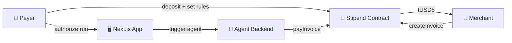

# Stipend

An allowance for your AI agent, enforced by a smart contract.

Built for the **Aevum Builder Challenge** on the Aevum testnet (chain ID 44005).

---

Stipend is a spending wallet for AI agents. You deposit tUSD8 into a vault and give an agent a limited permission. The agent can pay merchant invoices, but only inside the rules you set. Every rule is checked on-chain, every time, so even a buggy or manipulated agent cannot overspend.

## How it works

1. **Fund the vault.** The payer deposits tUSD8 into the Stipend contract.
2. **Set the rules.** For one agent address: a total budget, a per-payment cap, a daily limit, an expiry, and a list of approved merchants.
3. **Merchants send invoices.** A merchant wallet must first be on that agent's approved-merchant allowlist. It then calls `createInvoice(agent, amount)`; unapproved wallets are rejected.
4. **The agent pays.** The agent calls `payInvoice`. The contract checks every rule.
   - **Pass:** tUSD8 moves from the vault straight to the merchant and `InvoicePaid` is emitted.
   - **Fail:** nothing moves and `PaymentRejected` is emitted with a reason code.
5. **Stay in control.** The payer can revoke or reinstate the agent, reset its lifetime spent counter, pause the vault, withdraw accounted funds, or sweep tokens sent directly to the contract above its accounted balance.

There is no database. The blockchain is the source of truth.

## Roles and current limits

- **Payer.** The wallet that deployed the contract is the only payer. Only the payer can deposit, withdraw, set the agent's spending rules, approve merchants, revoke or reinstate the agent, reset spent, pause the vault, and sweep stray tokens.
- **Agent.** A separate wallet whose key stays on the server. It can only pay invoices, and only inside the payer's rules. The funds stay in the vault, never in the agent wallet.
- **Merchant.** Any wallet the payer has approved. Approved merchants can create invoices for the agent from their own wallet. Unapproved wallets are blocked, and the app shows "Your wallet is not an approved merchant for this agent."
- **Other users.** If a different wallet connects, it can view the app, but it can't change the vault unless it is the payer. To try a second user, approve their wallet as a merchant.
- **Current limit.** This version has one payer and one agent. One wallet acting as both payer and merchant works, but it pays itself. Multi-user vaults, where each wallet has its own vault, agents and rules, are planned as the next step.

## Architecture



## Tech stack

| Layer             | Technology                                                           |
| ----------------- | -------------------------------------------------------------------- |
| Smart contract    | Solidity 0.8.34, OpenZeppelin (ReentrancyGuard, Pausable, SafeERC20) |
| Contract tooling  | Hardhat 3, Hardhat Ignition, viem                                    |
| Frontend          | Next.js 16 (App Router), React 19, TypeScript                        |
| Wallet connection | RainbowKit, wagmi, viem                                              |
| Blockchain        | Aevum Testnet (chain 44005, RPC `https://rpc-test.qday.info`)        |
| Token             | tUSD8 (6 decimals) at `0x456569838f1d43009A91ebA4263147Afd7233483`   |

## Deployed contract

| Item             | Value                                                                                                                              |
| ---------------- | ---------------------------------------------------------------------------------------------------------------------------------- |
| Stipend contract | [`0xa05f94c4D521e69771Dd6bF75aafDE08d431812e`](https://explorer-test.qday.info/address/0xa05f94c4D521e69771Dd6bF75aafDE08d431812e) |
| Network          | Aevum Testnet (chain 44005)                                                                                                        |
| Explorer         | [explorer-test.qday.info](https://explorer-test.qday.info)                                                                         |

## Smart contract

The [`Stipend`](contract/contracts/stipend.sol) contract is a single-payer vault built on OpenZeppelin's `ReentrancyGuard`, `Pausable`, and `SafeERC20`.

### Key concepts

- **Payer** — the wallet that deploys and owns the vault. Only the payer can deposit, withdraw, sweep excess tokens, set policies, approve merchants, revoke or reinstate agents, reset an agent's spent counter, or pause and unpause the contract.
- **Policy** — per-agent spending rules stored on-chain: `totalBudget`, `perPaymentCap`, `dailyLimit`, `expiry`, `spent`, and `revoked`. Updating limits preserves `spent` and `revoked`; use `resetSpent(agent)` or `reinstate(agent)` explicitly for those actions.
- **Merchant allowlist** — a mapping of `(agent, merchant) → bool`. Only approved merchants can be paid.
- **Invoice** — created by an approved merchant with `createInvoice(agent, amount)`. The caller is recorded as the merchant; the transaction reverts unless that caller is approved for the specified agent.
- **Payment** — the agent calls `payInvoice(invoiceId)`. The contract runs through every rejection check before moving tokens.

### Rejection reasons

| Code                       | Reason                                        |
| -------------------------- | --------------------------------------------- |
| `None`                     | No rejection; payment can proceed             |
| `Revoked`                  | Agent permission was revoked by the payer     |
| `Expired`                  | Policy expiry timestamp has passed            |
| `MerchantNotAllowed`       | Merchant is not on the agent's allowlist      |
| `PaymentCapExceeded`       | Invoice amount exceeds the per-payment cap    |
| `BudgetExceeded`           | Payment would exceed the total budget         |
| `DailyLimitExceeded`       | Payment would exceed the daily spending limit |
| `InvoiceAlreadyPaid`       | Invoice was already settled                   |
| `InsufficientVaultBalance` | Vault does not hold enough tUSD8              |
| `WrongAgent`               | Invoice is assigned to a different agent      |
| `InvoiceNotFound`          | No invoice exists for the requested ID        |

### Contract tests

The test suite ([`contract/test/Stipend.ts`](contract/test/Stipend.ts)) uses Hardhat 3's native `node:test` runner and covers:

- Paying an approved invoice within all limits
- Rejecting payments above the per-payment cap
- Rejecting payments that exceed the total budget
- Rejecting payments that exceed the daily limit
- Rejecting payments after policy expiry
- Rejecting invoices from unapproved merchants
- Rejecting double-payment of the same invoice
- Rejecting payments from a revoked agent
- Blocking payments while the vault is paused
- Rejecting payments when vault balance is insufficient
- Rejecting payments from the wrong agent and for nonexistent invoice IDs
- Preventing the agent from withdrawing vault funds
- Preventing the agent from modifying its own policy
- Restricting payer-only actions, including `reinstate`, `resetSpent`, and `sweepExcess`
- Preserving `spent` and `revoked` when updating a policy
- Resetting spent without changing revocation and reinstating a revoked agent
- Sweeping only unaccounted excess tokens
- Additional policy validation, vault accounting, merchant-removal, daily-reset, and fee-on-transfer token cases
- Merchant list tracking: add, remove, re-add, swap-and-pop ordering, per-agent independence, and empty-list edge case
- Open invoice list tracking: creation adds to list, payment removes, pagination, offset past total, per-agent scoping, and rejected payments keeping invoices in list

The suite contains **45 test cases** in [`contract/test/Stipend.ts`](contract/test/Stipend.ts).

## Frontend pages

| Route        | Purpose                                                                                                           |
| ------------ | ----------------------------------------------------------------------------------------------------------------- |
| `/`          | Landing page — explains how Stipend works                                                                         |
| `/dashboard` | Vault overview: balance, agent allowance, daily spend, quick stats                                                |
| `/rules`     | Set spending policy (budget, cap, daily limit, expiry), manage the merchant allowlist, deposit and withdraw tUSD8 |
| `/invoices`  | Create new invoices (as a merchant) and view open invoices awaiting agent review                                  |
| `/agent`     | Trigger an agent run — the payer signs a message to authorize the server-side agent to process open invoices      |
| `/receipts`  | On-chain payment history pulled from `InvoicePaid` event logs                                                     |

## Agent backend

The server-side agent ([`backend/agent.ts`](backend/agent.ts)) runs when triggered from the `/agent` page or via a bearer-token API call. It:

1. **Authenticates** — either by verifying a payer-signed message (from the UI) or a bearer token (`AGENT_RUN_TOKEN`).
2. **Reads open invoices** — iterates through all invoices on the contract and filters for unpaid ones assigned to the agent.
3. **Checks every policy rule client-side first** — vault paused, agent revoked, expiry, merchant allowlist, per-payment cap, total budget, daily limit, and vault balance.
4. **Submits `payInvoice`** — for each eligible invoice, using the agent's private key.
5. **Logs and returns a decision array** — each invoice gets a `paid`, `blocked`, `rejected`, or `error` result with a reason.

## Getting started

### Prerequisites

- Node.js 20+
- A WalletConnect project ID (optional, for wallet modal)

### Install

```bash
# Frontend
npm install

# Smart contract
cd contract
npm install
```

### Configure environment

For local development, copy the example file to `.env.local` and fill in the values:

```bash
cp .env.example .env.local
```

For Vercel, add the same variables under **Project Settings → Environment Variables**. Set them for Production (and Preview if you deploy preview branches), then redeploy after changing them. `AGENT_PRIVATE_KEY` is required for the agent address and payment runner. Keep it server-only: do not prefix it with `NEXT_PUBLIC_`. A WalletConnect project ID is needed for wallet connections through WalletConnect.

| Variable                               | Description                                                          |
| -------------------------------------- | -------------------------------------------------------------------- |
| `AGENT_PRIVATE_KEY`                    | 0x-prefixed 32-byte private key for the agent wallet                 |
| `AGENT_RUN_TOKEN`                      | Optional bearer token for headless/cron agent runs; keep server-only |
| `NEXT_PUBLIC_WALLETCONNECT_PROJECT_ID` | WalletConnect project ID for the wallet modal                        |
| `STIPEND_CONTRACT_ADDRESS`             | Contract address used by the server agent                            |
| `NEXT_PUBLIC_STIPEND_CONTRACT_ADDRESS` | Same contract address, exposed to the client                         |

Keep both contract address variables set to the same deployed address. The example defaults to the current Aevum Testnet deployment. Vercel should use Node.js 20.9 or newer. The agent route runs on Node.js and allows up to five minutes per invocation to wait for invoice transactions to confirm.

### Deploy to Vercel

1. Import the repository into Vercel as a Next.js project. Use the repository root as the project root; the contract subdirectory is not part of the web build.
2. Add the environment variables above in Project Settings. Set `AGENT_PRIVATE_KEY` to the dedicated agent wallet key funded with Aevum test gas. Add a high-entropy `AGENT_RUN_TOKEN` only if you need bearer-token runs.
3. Set `NEXT_PUBLIC_WALLETCONNECT_PROJECT_ID` from WalletConnect Cloud, and set both contract address variables to the same deployed Stipend contract.
4. Deploy with the default Next.js build settings (`npm run build`).

`NEXT_PUBLIC_*` values are embedded into the client bundle at build time, so redeploy after changing them. Never commit `.env.local` or put a private key in a `NEXT_PUBLIC_*` variable.

### Run the app

```bash
npm run dev
```

The app starts at `http://localhost:3000`. Connect a wallet on Aevum Testnet to interact with the vault.
